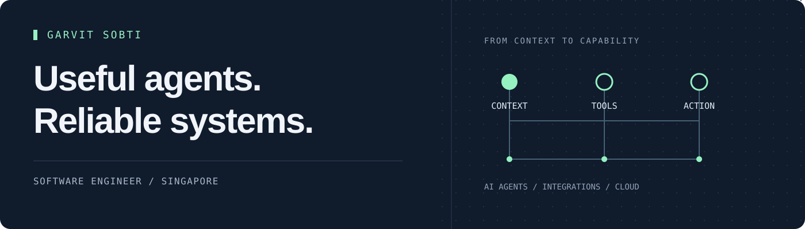

  

<h1 align="center">Garvit Sobti</h1>

  <strong>Software Engineer at ChatAndBuild · Computer Science at SMU, Class of 2028</strong> 
  Singapore · KKH Scholar, Wilmar Foundation

  <a href="https://www.linkedin.com/in/garvit-sobti-57954022a">LinkedIn</a> &nbsp; / &nbsp;
  <a href="mailto:garvit.s.2024@computing.smu.edu.sg">Email</a> &nbsp; / &nbsp;
  <a href="https://github.com/GarvitSobti?tab=repositories">Explore my repositories</a>

I build the software around AI agents: the integrations that give them context, the tools that let them act, and the backend systems that make those workflows reliable. My work also spans full-stack products, payments and cloud architecture.

**Open to applied AI and software engineering internships.**

## What I'm working on

At **ChatAndBuild**, I contribute to **ChatChat** and **Living Brain** across agent integrations, internal tools and user-facing features.

- **Agent capabilities:** Telegram, Discord, Garmin/Terra and Luma integrations using APIs, OAuth and webhooks.
- **Reliable tool use:** debugging context leakage, pagination, timezone handling and structured actions.
- **Developer tooling:** private-skill architecture, capability previews, and integration testing across REST, MCP, SDKs and CLI surfaces.

Previously, at **Osiris**, I built Stripe payment workflows, document/contract features and full-stack applications.

## Selected work

| Project | What I built or contributed to |
| --- | --- |
| **UBS × SMU-X Banking CRM** · academic team project | An eight-person banking CRM using React, microservices, AWS ECS Fargate and PostgreSQL, with Bedrock-assisted features. My contributions include transaction replay, versioned client-health rules, audit delivery and deployment configuration. |
| **[ChatChat Community Skills](https://github.com/GarvitSobti/chatchat-skills)** | Public skills workspace for ChatChat agents: structured instructions, supporting scripts and reusable task resources. Part of my work on the Skills and Connectors ecosystem. |
| **[CodeCollab](https://github.com/GarvitSobti/CodeCollab)** · team project | A platform for hackathon discovery, teammate matching and team collaboration, built with React, Node.js/Express, PostgreSQL and Socket.io. |
| **[TariffSheriff](https://github.com/SaaiAravindhRaja/TariffSheriff)** · team project | A trade-intelligence platform for tariff calculations and comparisons. Worked with React, Spring Boot, PostgreSQL, Auth0 and deployment workflows. |

<strong>More experiments</strong>

- **[In the frame](https://github.com/GarvitSobti/face-finder)** — An early browser-based event-photo finder using face embeddings and read-only Google Drive access. Prototype; full end-to-end validation is still pending.
- **[Streaming network analysis](https://github.com/GarvitSobti/streaming-analysis)** — Packet-capture and Python analysis workflows for RTT, jitter, bitrate and protocol comparisons across streaming platforms.

## Toolbox

**Languages** &nbsp; Python · TypeScript / JavaScript · Java · SQL · C / C++  
**Web & backend** &nbsp; React · Next.js · Spring Boot · Node.js / Express · PostgreSQL · Prisma  
**Agent integrations** &nbsp; MCP · REST APIs · OAuth 2.0 / OIDC · Webhooks · Skill workflows  
**Cloud & delivery** &nbsp; AWS · Terraform · GitHub Actions · Git

## Beyond the code

- **Teaching Assistant** for CS104 at Singapore Management University.
- **Technology Executive, Ellipsis @ SMU:** coding competitions and technical workshops; one of six core problem setters for Code#2025.
- **Farmer's Friend:** runner-up at the IBM EdTech International Challenge and featured in the Top 10 at the Intel AI Global Festival.

---

**Building something with agents, integrations or a useful backend?** [Let's talk.](mailto:garvit.s.2024@computing.smu.edu.sg)
